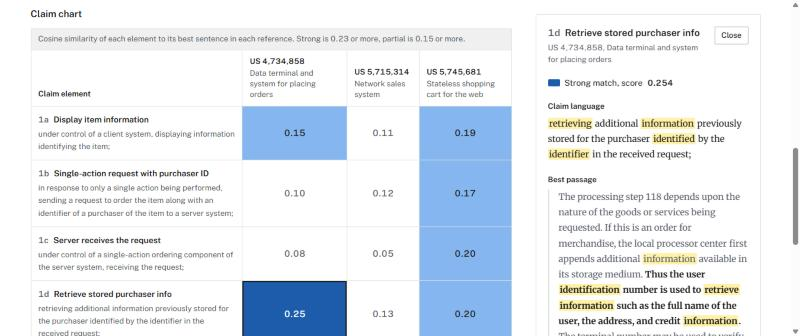
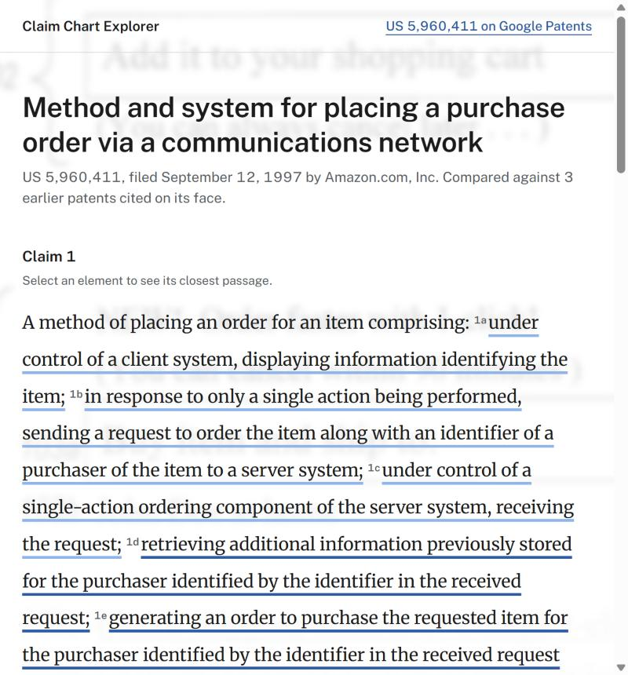
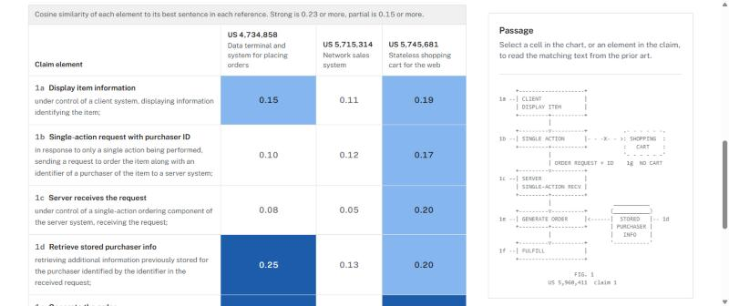
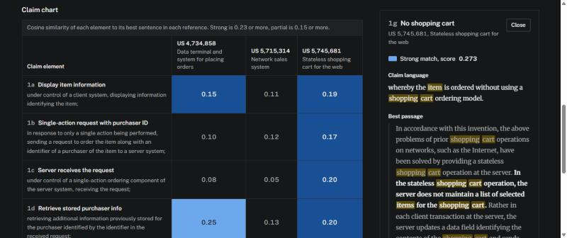

# Claim Chart Explorer

**Live demo: [claimchartexplorer.vercel.app](https://claimchartexplorer.vercel.app)**

An interactive claim chart for patent review. A patent claim is split into its elements, and each element is scored against passages from prior-art patents. The chart is shaded by how strongly the prior art covers each element, so a reviewer can spot an **uncovered element** (the start of a novelty argument) in seconds instead of reading every reference end to end.

Built with **Next.js 16 (App Router), React 19, TypeScript and Tailwind CSS**. The matching is a hand-written TF-IDF + cosine similarity engine in TypeScript, served from a Next.js API route. No external AI API is used.



| Annotated claim | ASCII patent figure | Dark mode |
| --- | --- | --- |
|  |  |  |

## The problem

Patent attorneys build claim charts by hand. They break a claim into elements ("[1a] displaying information identifying the item…") and search prior-art documents for passages that disclose each one. The chart that results shows, element by element, whether the prior art covers the invention. An element with no matching prior art is where the argument for novelty starts.

## What it does

- **Annotated claim.** The claim is shown as patent text, with each element underlined by its best coverage. A solid dark underline means strong, light means partial, and dashed gray means no strong match. Click an element to open its closest passage.
- **Claim chart table.** Rows are claim elements and columns are prior-art references. Cells are shaded on a one-hue blue scale (darker = stronger) and print their score.
- **Passage panel.** Click a cell to see the best-matching passage from that reference. The sentence that scored highest is set in bold, and words shared with the claim element are highlighted.
- **Coverage summary.** One sentence on how many elements are strongly covered, then a list of the ones that aren't, each with a button to its closest passage.
- **Patent figure.** Before a cell is selected, the panel shows an ASCII drawing of claim 1's method in the style of a patent drawing sheet ("FIG. 1"). Each box is numbered with its claim element.
- **Keyboard navigation.** Arrow keys (plus Home and End) move between cells, Enter or Space opens a cell or claim element, and Escape closes the panel.
- **Loading, error and empty states**, a responsive layout (the panel moves below the table on narrow screens), and dark mode.

## Sample data

The demo uses real, public USPTO patent text:

- **Claim under review:** claim 1 of [US 5,960,411](https://patents.google.com/patent/US5960411A/en) (Amazon's "1-Click" patent, filed 1997), split into 7 elements.
- **Prior art** (all cited on the face of that patent):
  - [US 4,734,858](https://patents.google.com/patent/US4734858A/en), *Data terminal and system for placing orders* (Portel, 1984)
  - [US 5,715,314](https://patents.google.com/patent/US5715314A/en), *Network sales system* (Open Market, 1994)
  - [US 5,745,681](https://patents.google.com/patent/US5745681A/en), *Stateless shopping cart for the web* (Sun Microsystems, 1996)

The scorer finds strong prior art for retrieving stored purchaser data, generating the order and fulfilling it (elements 1d–1f). It finds **no strong match for 1b, the "single action" order request**, which is the part of the claim that made it novel.

## How it works

```
src/
├── data/claimChart.json        # claim elements + prior-art passages (verbatim patent text)
├── lib/
│   ├── types.ts                # shared TypeScript types for the data and the API response
│   ├── tfidf.ts                # tokenizer, stemmer, sentence splitter, TF-IDF, cosine
│   ├── matcher.ts              # scores every element against every reference
│   └── highlight.ts            # splits text into highlighted / plain segments
├── app/
│   ├── api/match/route.ts      # GET /api/match → scored chart as JSON
│   ├── page.tsx                # Server Component: page shell + header
│   └── layout.tsx
└── components/
    ├── ClaimChartExplorer.tsx  # Client Component: fetches data, owns state
    ├── ClaimText.tsx           # the claim, each element underlined by coverage
    ├── PatentFigure.tsx        # ASCII "FIG. 1" drawing of the claimed method
    ├── ChartTable.tsx          # the grid, with roving-tabindex keyboard navigation
    ├── PassagePanel.tsx        # side panel with highlighted passage
    ├── SummaryBar.tsx          # coverage sentence + list of gaps
    └── strength.ts             # fills/underlines for strong/partial/weak, score formatting
```

### Scoring (`lib/tfidf.ts`, `lib/matcher.ts`)

1. **Tokenize.** Lowercase the text, keep only words, and drop stopwords (including patent boilerplate like "wherein" and "said"). A small stemmer maps "ordered", "ordering" and "orders" to `order`, and "identifier" and "identification" to `ident`.
2. **IDF.** Over all claim elements and passages, compute `idf = ln((1 + N) / (1 + df)) + 1`. Rare words ("cart", "purchaser") get high weight, and common ones ("computer") get low weight.
3. **Vectors.** Each claim element, and each *sentence* of each passage, becomes a vector of `term count × idf`.
4. **Cosine similarity** between an element and each sentence. A cell's score is the best sentence in that reference. Scoring sentences rather than whole paragraphs keeps a one-line claim element from being diluted by a long paragraph that only matches in one place.
5. **Buckets.** Scores ≥ 0.23 are *strong*, 0.15–0.23 are *partial*, and anything lower is *weak*. These cut-offs were tuned on the sample data.

### Data flow

`page.tsx` is a **Server Component**. It renders the static header on the server and mounts `<ClaimChartExplorer />`, a **Client Component** (`"use client"`). That component:

- fetches `/api/match` in a `useEffect`, with an `AbortController` so a stale request never updates state;
- keeps the request in a discriminated-union state (`loading | error | ready`), so TypeScript only allows reading `data` once it has loaded;
- holds the selected cell in state and passes data down to `ChartTable`, `PassagePanel` and `SummaryBar` as **props**. The children report clicks back up through callback props (`onSelect`, `onClose`, `onJump`).

The API route only reads a bundled JSON file. With Next.js Cache Components, it is **prerendered at build time** and served as a static response.

### Design

The goal is to look like a working research tool, not a landing page. Every visual choice has a reason in the subject:

- **The claim leads.** The page opens with the patent claim itself, annotated with coverage, because that's the thing a patent reviewer actually reads.
- **Type from the patent office's world.** [Public Sans](https://public-sans.digital.gov) for the interface and Merriweather for patent text, the two typefaces of the [US Web Design System](https://designsystem.digital.gov) the USPTO belongs to. The serif appears *only* on text quoted from patents, so the typeface tells you whose words you're reading.
- **Color encodes one thing.** Neutrals are USWDS cool grays on white. Match strength is an ordered scale, so it uses a single blue hue, light to dark. Weak cells have no fill, so gaps read as empty. Each fill clears 2:1 against the page and all text on it clears 4.5:1. Dark mode flips the scale so "strong" stays the most prominent.
- **No decoration.** No eyebrow labels, numbered sections, all-caps or mono text, or gradients. Headings are sentence case, corners are 2px, and gridlines exist because it's a table.

- **A background from the patent itself.** Behind the header is Fig. 1A of US 5,960,411, the patent's drawing of the original 1-Click button beside the old "Add it to your shopping cart" button, which is the contrast claim element 1g is about. It has a 3px blur at 18% opacity and fades out before the chart. 18% is the ceiling: after the blur the darkest stroke is about 70% strength, and at 18% every text color over it still clears 4.5:1 in both modes. Dark mode inverts the line art.

All tokens live in `src/app/globals.css`.

### Limitations

TF-IDF compares words, not meaning, so a few things are out of reach:

- **Negation.** Element 1g says the item is ordered "*without* using a shopping cart", yet it scores *strong* against the Sun and Open Market passages, because those passages talk about shopping carts constantly. This is the kind of false positive a human reviewer, or a semantic model, has to catch.
- **Synonyms.** "purchaser" and "user/consumer/buyer" don't match, which under-scores some real disclosures.
- **Thresholds** are tuned to this data set. They are not universal.

Natural next steps: embedding-based similarity, letting users paste their own claim and references, and exporting the chart as a table for a brief.

## Running locally

Requires Node.js 20.9 or later.

```bash
npm install
npm run dev        # http://localhost:3000
```

Other scripts:

```bash
npm test           # Jest + React Testing Library
npm run typecheck  # tsc --noEmit
npm run lint
npm run build      # production build
```

## Tests

`__tests__/` contains 23 tests:

- **`tfidf.test.ts`:** stemming, tokenizing, sentence splitting around "FIG." and "U.S. Pat. No.", IDF ordering, and cosine edge cases
- **`matcher.test.ts`:** picks the right passage and sentence, handles elements with zero overlap, threshold buckets, and checks the sample data
- **`highlight.test.ts`:** highlighting keeps the original text intact
- **`route.test.ts`:** `GET /api/match` returns well-formed JSON
- **`ClaimChartExplorer.test.tsx`:** loading → chart, click to open and Escape to close the panel, opening a passage from the claim text, arrow-key navigation, the gap list in the summary, error + retry, and the empty state

## Deploying to Vercel

1. Push this repo to GitHub.
2. On [vercel.com/new](https://vercel.com/new), import the repo. Vercel detects Next.js and needs no configuration.
3. Deploy. Every push to `main` then redeploys automatically.

This project is deployed at [claimchartexplorer.vercel.app](https://claimchartexplorer.vercel.app). Deployment-specific URLs (the ones with a random suffix) are behind Vercel Authentication by default; share the production domain instead.

## Disclaimer

Patent text and the Fig. 1A drawing are from USPTO documents via Google Patents. Scores measure word overlap only and are not a legal opinion.
